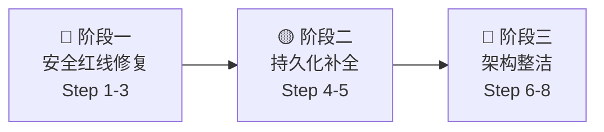

# AERO 系统改造完善计划

> **基于代码审查报告**：[AERO-CODE-REVIEW.md](file:///C:/Users/Administrator/.gemini/antigravity-cli/brain/2519a705-3c12-4a58-8a30-2bd3d419a786/AERO-CODE-REVIEW.md)  
> **原则**：稳定优先，不动生产数据，模块独立，每步验证后再推进  
> **Git 纪律**：每步完成后本地 commit，**严禁未经授权 push**

---

## 总览：三阶段八步



| 阶段 | 步骤 | 核心目标 | 估时 | 风险等级 |
|---|---|---|---|---|
| 🔴 一：安全红线 | Step 1-3 | 消灭可被利用的漏洞 | 1-2 天 | 高（需仔细测试） |
| 🟡 二：持久化补全 | Step 4-5 | 重启不丢生产数据 | 1-2 天 | 中 |
| 🔵 三：架构整洁 | Step 6-8 | 降低维护成本 | 3-5 天 | 低 |

---

## 阶段一：安全红线修复（必须优先执行）

### Step 1 — 修复订阅签名验证逻辑

> **问题**：客户端用订阅内容自带的 `token` 验签，攻击者可伪造订阅绕过校验。  
> **位置**：[`protocol/client/public/engine.go`](file:///D:/jacky/gemini/aisys/protocol/client/public/engine.go#L556-L560)  
> **影响**：中间人可替换节点地址，导致流量被劫持到恶意服务端。

#### 修改范围
- `protocol/client/public/engine.go`（`loadSubscription` 函数）
- `protocol/client/internal/sub/sign.go`（`Verify` 函数）
- `sub/vpn/internal/modules/subscription/handler/http.go`（`ServeSub` 加签逻辑）

#### 目标方案：SPKI Pin 作为隐式信任锚

当订阅中包含 `pin_spki` 字段时，客户端已经对服务端证书做了 SPKI 钉扎验证（TLS 握手层），即已建立了对服务端的信任。基于此，对签名逻辑的改进分两步：

**短期（本次修改）**：  
移除"用订阅内 token 自验"逻辑，改为：
1. 如果订阅包含 SPKI Pin 且 TLS 握手已验证 → 允许无签名订阅通过（信任来自 TLS 层，不重复校验）；
2. 如果订阅包含签名 → 要求调用方在客户端配置文件中预置 HMAC 密钥（`sub_verify_key`），用该密钥验证；
3. 如果既无 Pin 又无有效签名 → 降级警告，记录日志，但当前版本仍允许（渐进式加固，不硬断老节点）。

**改动示意**：

```go
// engine.go loadSubscription — 修改后逻辑
func loadSubscription(src string) (*sub.Applied, error) {
    // ...拉取 doc...
    
    // 新验证逻辑（分三级）
    hasPins := len(doc.Servers) > 0 && len(doc.Servers[0].PinSPKI) > 0
    hasSig  := doc.Signature != ""
    
    if hasSig {
        // 优先：用配置文件中的 sub_verify_key 验证
        if verifyKey := loadSubVerifyKey(); len(verifyKey) > 0 {
            if !sub.Verify(doc, verifyKey) {
                return nil, fmt.Errorf("subscription signature invalid (key mismatch)")
            }
        }
        // 没有配置 verifyKey 时，有签名但无法验证 → 警告
    } else if !hasPins {
        log.Printf("[SUB] WARN: subscription has no signature and no SPKI pins — consider upgrading server")
    }
    // hasPins 且无签名 → TLS 层已做信任，此处不阻断
    // ...
}
```

#### 验证方法
```powershell
# 1. 单元测试：签名验证逻辑
cd protocol\client\internal\sub
go test -v -run TestVerify .

# 2. 集成测试：完整订阅生命周期
go test -v -run TestSubscriptionLifecycleAndVerification .

# 3. 真实 VPS 拉取验证（不中断正常流程）
go test -v -run TestLiveFetchBothVPS .
```

#### 成功标准
- [ ] 携带正确 SPKI Pin 的真实节点订阅正常拉取，连接成功；
- [ ] 用错误密钥验签的订阅被拦截并返回明确错误；
- [ ] 所有现有测试 PASS，0 regression。

---

### Step 2 — 禁止弱 HMAC 密钥启动中台

> **问题**：`hmacSecret` 有 `"dev-secret-change-me"` 默认值，生产未配置则用弱密钥签发 JWT。  
> **位置**：[`sub/vpn/main.go`](file:///D:/jacky/gemini/aisys/sub/vpn/main.go#L126-L132)

#### 修改范围
仅 `sub/vpn/main.go` 的 `main()` 函数，约 5 行。

#### 目标方案

```go
// 修改前
hmacSecret := "dev-secret-change-me"
if cfg != nil && cfg.Security.HMACSecret != "" {
    hmacSecret = cfg.Security.HMACSecret
}
if s := os.Getenv("HMAC_SECRET"); s != "" {
    hmacSecret = s
}

// 修改后
hmacSecret := ""
if cfg != nil && cfg.Security.HMACSecret != "" {
    hmacSecret = cfg.Security.HMACSecret
}
if s := os.Getenv("HMAC_SECRET"); s != "" {
    hmacSecret = s
}
if len(hmacSecret) < 32 {
    log.Fatalf("[SECURITY] HMAC_SECRET must be at least 32 chars. " +
        "Set it in config.yaml (security.hmac_secret) or HMAC_SECRET env var. " +
        "Generate with: openssl rand -hex 32")
}
```

同时在 [`sub/vpn/config/config.yaml`](file:///D:/jacky/gemini/aisys/sub/vpn/config/config.yaml) 注释中增加生成命令提示。

#### 验证方法
```bash
# 1. 不设置 HMAC_SECRET，应 Fatal 退出
HMAC_SECRET="" go run . 
# 期望输出：[SECURITY] HMAC_SECRET must be at least 32 chars...

# 2. 设置合法密钥，正常启动
HMAC_SECRET=$(openssl rand -hex 32) go run .
# 期望：正常启动，监听 18080
```

#### 成功标准
- [ ] 无 HMAC_SECRET 时启动即 Fatal，日志给出生成命令；
- [ ] 有效密钥下正常启动，原有 token 逻辑不受影响；
- [ ] `live_sub_test.go` 测试仍然 PASS（中台功能无 regression）。

---

### Step 3 — 修复 admin 初始密码机制

> **问题**：`seedAdmin` 硬编码 `admin123`，运营商可能从不修改。  
> **位置**：[`sub/vpn/main.go`](file:///D:/jacky/gemini/aisys/sub/vpn/main.go#L291-L306)

#### 修改范围
仅 `sub/vpn/main.go` 的 `seedAdmin` 函数，约 15 行。

#### 目标方案

```go
// 修改后 seedAdmin
func seedAdmin(svc *userS.Service, db userStore.Store) {
    existing, err := db.GetUserByUsername("admin")
    if err == nil && existing != nil {
        if !existing.IsStaff {
            db.SetStaff(existing.ID, true)
        }
        return
    }
    
    // 优先从环境变量读取初始密码
    initPwd := strings.TrimSpace(os.Getenv("ADMIN_INIT_PASSWORD"))
    if initPwd == "" {
        // 随机生成，打印到日志（仅首次启动可见）
        b := make([]byte, 12)
        rand.Read(b)
        initPwd = base64.StdEncoding.EncodeToString(b)
        log.Printf("========================================")
        log.Printf("[SECURITY] Admin created with random password: %s", initPwd)
        log.Printf("[SECURITY] Set ADMIN_INIT_PASSWORD env var to customize.")
        log.Printf("========================================")
    }
    
    u, err := svc.Register(domain.CreateUserParams{
        Username: "admin", Password: initPwd, Email: "admin@vpn.local",
    })
    if err != nil {
        return
    }
    db.SetStaff(u.ID, true)
}
```

#### 验证方法
```bash
# 1. 首次启动，无 ADMIN_INIT_PASSWORD：查看随机密码日志
go run . 2>&1 | grep SECURITY

# 2. 设置固定密码
ADMIN_INIT_PASSWORD="MyStrongPwd123!" go run .
# 期望：admin 以该密码创建，不打印随机密码

# 3. admin 已存在时再次启动：无输出，跳过 seed
```

#### 成功标准
- [ ] 首次启动日志中出现随机密码，可用该密码登录后台；
- [ ] 配置 `ADMIN_INIT_PASSWORD` 后使用指定密码；
- [ ] 重复启动（admin 已存在）正常跳过，无重复创建。

---

## 阶段二：持久化补全

### Step 4 — 为 subscription 模块增加 FileStore

> **问题**：用户专属订阅记录（绑定 UserID 与 NodeID 的 `Subscription`）使用 `MemoryStore`，服务重启后用户订阅数据全部丢失，前端会显示"无订阅"。  
> **位置**：[`sub/vpn/internal/modules/subscription/store/store.go`](file:///D:/jacky/gemini/aisys/sub/vpn/internal/modules/subscription/store/store.go)

#### 修改范围
- 新增 `sub/vpn/internal/modules/subscription/store/file.go`（约 120 行，完全参照 `user/store/file.go` 的原子落盘模式）
- 修改 `sub/vpn/main.go` 中初始化 `subSvc` 的代码（约 3 行）

#### 目标方案（file.go 结构）

```go
// sub/vpn/internal/modules/subscription/store/file.go （新增文件）
package store

type subSnapshot struct {
    NextID uint64                     `json:"next_id"`
    Subs   map[uint64]*domain.Subscription `json:"subs"`
}

type FileStore struct {
    mu   sync.RWMutex
    path string
    subs map[uint64]*domain.Subscription
    next uint64
}

func NewFileStore(path string) (*FileStore, error) { ... }
func (f *FileStore) persistLocked() error {
    // .tmp → rename 原子落盘（与 user FileStore 完全一致）
}
// 实现 Store 接口的全部方法：Create / GetByUUID / ListAll / Delete / 
//                            DeactivateByNodeID / DeleteByNodeID
```

**main.go 修改**（3 行替换）：

```go
// 修改前
subSvc := subS.New(subStore.NewMemoryStore())

// 修改后
subPath := filepath.Join(dataDir, "subscriptions.json")
subDB, err := subStore.NewFileStore(subPath)
if err != nil {
    log.Printf("[WARN] sub file store failed (%v), falling back to memory", err)
    subSvc = subS.New(subStore.NewMemoryStore())
} else {
    subSvc = subS.New(subDB)
    log.Printf("sub store: %s", subPath)
}
```

#### 验证方法
```bash
# 1. 启动服务，创建一个订阅，重启服务
go run .     # 创建订阅
Ctrl+C       # 停止
go run .     # 重启

# 2. 查询订阅列表，数据应保留
curl http://127.0.0.1:18080/api/v1/subscriptions/ -H "Authorization: Bearer <token>"

# 3. 运行订阅模块测试
cd sub/vpn/internal/modules/subscription
go test -v ./...
```

#### 成功标准
- [ ] 重启前后 `/api/v1/subscriptions/` 返回相同数据；
- [ ] `subscriptions.json` 文件以 `.tmp → rename` 方式原子写入；
- [ ] 写入失败时优雅降级为 MemoryStore，不 Fatal；
- [ ] 0 regression（existing tests PASS）。

---

### Step 5 — endpoint 增加显式 region 字段

> **问题**：`snimatrix.normalizeRegion` 依赖节点 name 字符串中的关键字（如"JP"）推断区域，命名不规范时 SNI 匹配退化为 DEFAULT，完全无法感知。  
> **位置**：`sub/vpn/internal/modules/vps/aero/endpoint`、`snimatrix/matrix.go`

#### 修改范围
- `sub/vpn/internal/modules/vps/aero/endpoint`（endpoint 结构体加 `Region` 字段）
- `sub/vpn/internal/modules/subscription/snimatrix/matrix.go`（`normalizeRegion` 加备注逻辑）
- `sub/vpn/internal/modules/subscription/handler/http.go`（`ServeSub` 传 region 时优先取 endpoint.Region）
- `sub/vpn/data/aero_endpoints.json`（对已有数据补充 region 字段）

#### 目标方案

**endpoint 结构体**（加一个字段）：
```go
type Endpoint struct {
    // ...现有字段...
    Region string `json:"region,omitempty"` // 显式区域：JP/HK/US/DE/SG/等
}
```

**ServeSub 传参优先级**：
```go
// 修改后：region 优先取 endpoint.Region，次才从 name+host 推断
region := ep.Region
if region == "" {
    region = ep.Name + " " + host  // fallback，维持向后兼容
}
sni := h.sniMgr.Match(isp, region)
```

**data/aero_endpoints.json 更新示例**：
```json
{
  "vps_id": 2,
  "name": "vps-a",
  "host": "myconsun.de5.net",
  "region": "DE",
  ...
}
```

#### 验证方法
```bash
# 1. 修改 aero_endpoints.json，region 设置为 "DE"
# 2. 启动服务，拉取订阅（模拟 china_telecom ISP）
curl "http://127.0.0.1:18080/sub/<slug>?isp=china_telecom"
# 期望：servers[0].sni 匹配 sni_matrix.json 中 china_telecom.routes.DE 的第一条

# 3. 测试矩阵单元测试
cd sub/vpn/internal/modules/subscription
go test -v ./snimatrix/...
```

#### 成功标准
- [ ] endpoint 有 `region: "DE"` 时，SNI 准确匹配到德国区规则；
- [ ] endpoint 无 region 字段时，老逻辑照常工作（向后兼容）；
- [ ] `matrix_test.go` 全部 PASS。

---

## 阶段三：架构整洁（提升可维护性）

### Step 6 — 修复 `h2Tunnel.closed` 数据竞争

> **问题**：`h2Tunnel.closed` 是普通 `bool`，`Read` 无锁读，`Close` 有锁写，存在 data race。  
> **位置**：[`protocol/client/public/tunnel.go`](file:///D:/jacky/gemini/aisys/protocol/client/public/tunnel.go#L200-L210)  
> **风险**：低（仅改两行），但 data race 会导致内存安全问题，应尽早修复。

#### 修改范围
仅 `tunnel.go` 的 `h2Tunnel` 结构体定义及引用处，约 5-8 处。

#### 目标方案
```go
// 修改前
type h2Tunnel struct {
    ...
    closed    bool
}
func (t *h2Tunnel) Read(p []byte) (int, error) {
    if t.closed { ... }  // 无锁读
}

// 修改后
type h2Tunnel struct {
    ...
    closed    atomic.Bool  // 与 aeroStreamConn 保持一致
}
func (t *h2Tunnel) Read(p []byte) (int, error) {
    if t.closed.Load() { ... }  // 原子读
}
func (t *h2Tunnel) Close() error {
    t.writeMu.Lock()
    defer t.writeMu.Unlock()
    if t.closed.Swap(true) { return nil }  // 原子 CAS
    ...
}
```

#### 验证方法
```powershell
# race detector 验证
cd protocol\client\public
go test -race -v -run TestLive .
# 期望：DATA RACE 不再出现在 h2Tunnel
```

#### 成功标准
- [ ] `-race` 跑全测试，h2Tunnel 无 DATA RACE 报告；
- [ ] 双 VPS 握手测试（`TestLiveTunnelDualVPS`）全部 PASS。

---

### Step 7 — 优化 `isAITraffic` 热路径

> **问题**：每次代理连接都创建临时 slice，30+ 条域名字符串，在高并发时浪费内存和 GC。  
> **位置**：[`protocol/client/public/engine.go`](file:///D:/jacky/gemini/aisys/protocol/client/public/engine.go#L666-L687)

#### 修改范围
仅 `engine.go` 约 30 行，提取为包级 `map` 或实现后缀匹配。

#### 目标方案

```go
// 修改后：包级初始化，一次分配，O(1) 查询
var aiDomainSet = buildAIDomainSet()

func buildAIDomainSet() map[string]struct{} {
    domains := []string{
        "openai.com", "api.openai.com", "chatgpt.com", ...
        // 同原列表
    }
    m := make(map[string]struct{}, len(domains))
    for _, d := range domains {
        m[d] = struct{}{}
    }
    return m
}

func isAITraffic(host string) bool {
    h := strings.ToLower(host)
    // 精确匹配
    if _, ok := aiDomainSet[h]; ok {
        return true
    }
    // 后缀匹配：检查 .openai.com 等父域
    for d := range aiDomainSet {
        if strings.HasSuffix(h, "."+d) {
            return true
        }
    }
    return false
}
```

#### 验证方法
```powershell
# 基准测试对比（改前后）
go test -bench=BenchmarkIsAITraffic -benchmem .
```

#### 成功标准
- [ ] `isAITraffic` 不再在每次调用时分配 slice；
- [ ] 现有代理功能无 regression（`TestLiveProxySwitching` PASS）。

---

### Step 8 — 拆分 `public` God Package 并规范分层

> **问题**：`public` 包 22 个文件混杂五种职责，`subscription/handler` 跨模块直接依赖 Store，`gate.go` ACL 硬编码。  
> **这是工程量最大的一步，应拆成 3 个子任务。**

#### Step 8a — 拆分 `public` 包内文件

将合并文件恢复为独立职责文件：

| 现状（合并大文件） | 拆分目标 |
|---|---|
| `tunnel.go`（660行，5个Source） | → `aero_stream.go` + `h2tunnel.go` + `tunnel_handshake.go` + `tunnel_heartbeat.go` + `tunnel_loop.go` |
| `engine_dialer.go`（607行，5个Source） | → `transport_h2.go` + `transport_quic.go` + `transport_select.go` + `direct.go` + `probe.go` + `nonce.go` |
| `engine.go`（716行，订阅+日志+ISP+Config） | → `subscription_manager.go`（订阅相关）+ `engine_init.go`（CLI flags和初始化）+ `engine.go`（保留核心代理循环） |
| `tun.go`（648行，含测试用 sim） | → `tun_runtime.go` + `tun_adapters.go` + `sim_test_helper.go` |

> [!NOTE]
> 这一步纯粹是文件移动和包内重组，不改变任何逻辑和接口，只要确保包名不变，就不会有编译问题。

**工作方式**：
1. 新建目标文件，将 `// Source: xxx.go` 注释块之间的代码移入对应文件；
2. 删除源文件中已移走的代码段；
3. `go build ./...` 验证编译通过；
4. 全测试验证行为不变。

#### Step 8b — 修复 `subscription/handler` 分层违规

将 handler 中直接操作跨模块 Store 的逻辑下沉到 Service 层：

```go
// 修改前：handler 直接持有跨模块 Store
type Handler struct {
    svc       *service.Service
    userStore userStore.Store        // 跨模块 Store
    epStore   *aeroEndpoint.Persist  // 跨模块 Store
    sniMgr    *snimatrix.Manager
}

// 修改后方案 A（推荐，接口注入）：
// 在 subscription/service 层增加 NodeProvider 接口
type NodeProvider interface {
    ListEndpoints() []EndpointInfo  // EndpointInfo 为本模块定义的 DTO
}
type UserProvider interface {
    GetBySlug(slug string) (*UserInfo, error)
}

type Service struct {
    store        Store
    nodeProvider NodeProvider
    userProvider UserProvider
    sniMgr       *snimatrix.Manager
}

// handler 只依赖 Service
type Handler struct {
    svc *service.Service
}
```

main.go 中通过适配器（Adapter）注入：

```go
// main.go 中组装
subSvc := subS.NewWithProviders(subDB,
    subS.EndpointAdapter(epStore),  // 适配器实现 NodeProvider
    subS.UserAdapter(userDB),       // 适配器实现 UserProvider
    sniMgr,
)
subH.New(subSvc).RegisterRoutes(api)
```

#### Step 8c — ACL 注册化（替换 gate.go 硬编码）

将白名单从 if-else 字符串比较改为注册模式：

```go
// middleware/gate.go 改为注册式
type RouteRule struct {
    Method  string // "" = any
    Pattern string // 支持前缀匹配
    Public  bool
    UserOnly bool
}

var defaultRules []RouteRule

// 各模块在 RegisterRoutes 时同时声明权限
func (h *Handler) RegisterRoutes(mux *http.ServeMux, gate *middleware.Gate) {
    mux.HandleFunc("GET /api/v1/subscriptions/config/", h.GetConfig)
    gate.AddPublicRoute("GET", "/api/v1/subscriptions/config/")  // 一处声明
}
```

#### 验证方法（Step 8 整体）
```powershell
# 每个子任务完成后运行
go vet ./...
go test -race ./...
go test -v -run TestLive ./protocol/client/public/...
go test -v ./sub/vpn/...
```

#### 成功标准
- [ ] `go vet ./...` 全清，0 告警；
- [ ] `-race` 全测试无 DATA RACE；
- [ ] `public` 包无任何文件超过 400 行；
- [ ] `subscription/handler` 不直接 import 跨模块 store；
- [ ] 双 VPS 真实握手测试全部 PASS。

---

## 附录 A：每步完成的 commit 规范

```
Step 1: fix(security): replace self-signed subscription verification with SPKI-anchored trust
Step 2: fix(security): require HMAC_SECRET >= 32 chars, no insecure default
Step 3: fix(security): randomize admin initial password, add ADMIN_INIT_PASSWORD env
Step 4: feat(sub): add FileStore persistence for subscription records
Step 5: feat(endpoint): add explicit region field, fix SNI matrix region inference
Step 6: fix(race): convert h2Tunnel.closed to atomic.Bool to eliminate data race
Step 7: perf(proxy): convert isAITraffic domain list to package-level map
Step 8a: refactor(public): split merged source files back to single-responsibility files
Step 8b: refactor(sub): fix handler layer violation, inject NodeProvider/UserProvider interfaces
Step 8c: refactor(middleware): replace hardcoded ACL with route registration pattern
```

---

## 附录 B：绝对禁止事项（整个改造期间）

> [!CAUTION]
> 以下操作在改造过程中严格禁止：

1. **禁止**修改 `sub/vpn/data/` 目录下的生产数据文件（`vps.json`、`aero_endpoints.json`、`sni_matrix.json`）——除非是 Step 5 中明确为 endpoint 增加 `region` 字段；
2. **禁止** `git push` 未经用户明确授权；
3. **禁止**在未运行完整测试套件前合并两步以上的修改；
4. **禁止**在 `protocol/server`（生产 Edge）上因客户端改动而重新部署；
5. **禁止**跨子树导入（`protocol` ↔ `sub` ↔ `connect` 之间严禁 import）。

---

## 附录 C：改造完成后的健康度量基线

| 指标 | 改造前 | 目标 |
|---|---|---|
| 弱密钥启动 | 允许（默认值） | ❌ Fatal 退出 |
| admin 初始密码 | `admin123` | ✅ 随机/环境变量 |
| 订阅重启丢失 | 是（内存） | ✅ 持久化（文件） |
| h2Tunnel data race | 存在 | ✅ 消除 |
| `public` 包最大文件行数 | 716 行 | ≤ 400 行 |
| isAITraffic 每次调用内存分配 | 有（临时 slice） | ✅ 零分配（包级 map） |
| subscription handler 跨模块依赖 | 3 个跨模块 Store | ✅ 0（全走接口） |
| `-race` 测试结果 | 未知 | ✅ 0 DATA RACE |
